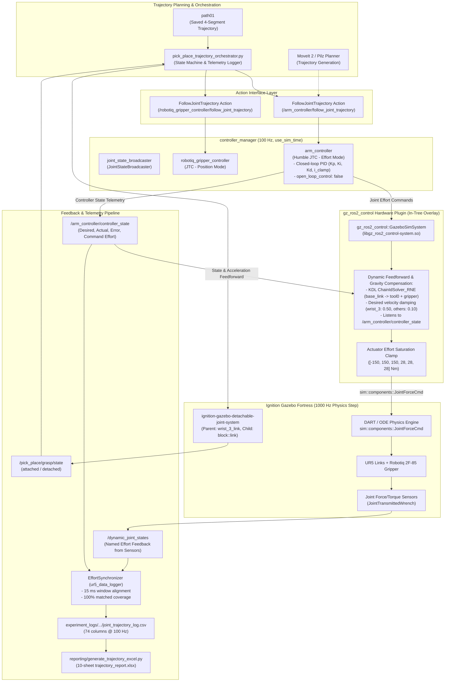

# UR5 Control Chain & Data Flow (Phase 1)

**Inspection Date:** 2026-10-30  
**Target:** Architecture and control chain diagram from planning reference to Gazebo plant and telemetry.

---

## 1. Control Chain Architecture Diagram

---

## 2. Key Observations on the Control Chain

1. **Effort Control is Already Active in Baseline C1:**
   - The arm is commanded via `sim::components::JointForceCmd` (torques in N·m).
   - In `ros2_controllers_effort.yaml`, `arm_controller` claims `command_interfaces: [effort]`.
2. **KDL Dynamics Feedforward in the Hardware Layer:**
   - The custom overlay `gz_ros2_control` in `gz_ros2_control_src` incorporates an internal KDL Recursive Newton-Euler solver (`KDL::ChainIdSolver_RNE`).
   - It computes nominal rigid-body gravity compensation (`base_link` to `tool0` + 0.9209 kg Robotiq gripper) and damping feedforward.
   - The baseline JTC's PID output (`Kp*e + Ki*∫e + Kd*ė`) is *added* to this gravity compensation torque inside `gz_system.cpp` before clamping to joint torque limits.
3. **Telemetry Synchronization:**
   - Command torques originate from JTC's internal PID (`msg.output.effort` on `/arm_controller/controller_state`).
   - Measured joint reaction efforts are read from `/dynamic_joint_states` (published by Gazebo's force/torque sensor components).
   - `EffortSynchronizer` strictly matches timestamps between the two without stale fallbacks.

